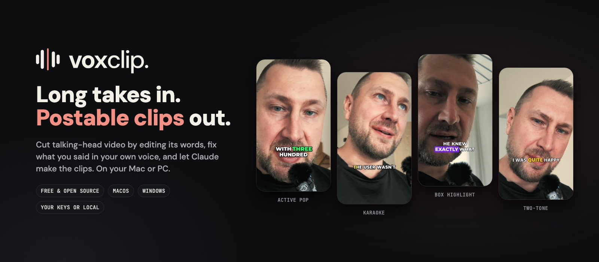
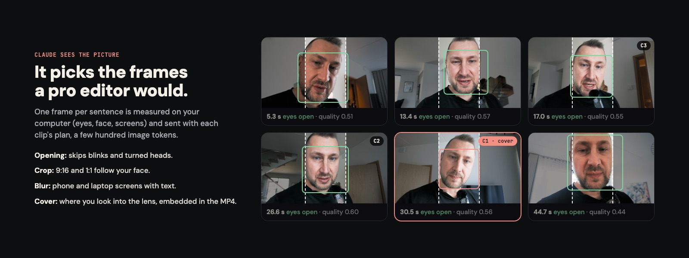
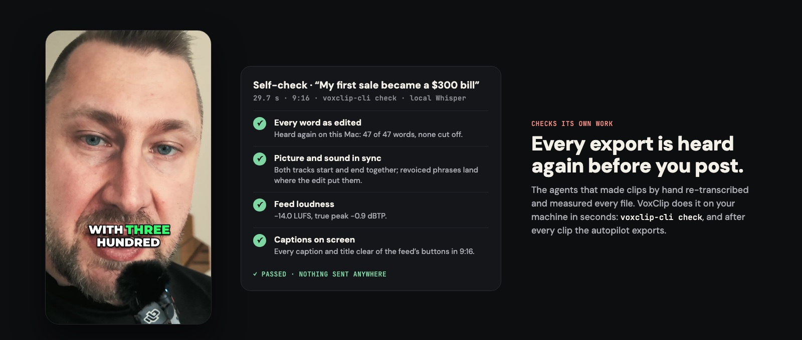

<p align="center">
  
</p>

<p align="center">
  <b>Turn a long talking-head recording into postable clips, and fix what you said in your own voice.</b><br>
  Free and open source for macOS and Windows. Bring your own keys and your Claude plan, or run everything locally.
</p>

<p align="center">
  <a href="https://github.com/Siim/voxclip/releases">Download</a> ·
  <a href="#what-it-does">What it does</a> ·
  <a href="#how-fast">How fast</a> ·
  <a href="#for-agents">For agents</a> ·
  <a href="#build-from-source">Build from source</a>
</p>

---

## ✦ Claude does it all

Drop in a 30-minute recording and click once. About two minutes later your first clip is ready:

- the strongest moments are picked;
- the clip is cut on word boundaries, with fillers and dead air removed;
- it is captioned, framed on your face in 9:16 and matched to feed loudness;
- it comes with a cover, a title and post text.

The rest follow while you watch the first. Every choice shows up as a row you can undo, and nothing paid runs past the cap you set.

## What it does

### Edit video by editing words
VoxClip transcribes your take with word timestamps, so cutting is just deleting text. Fillers and long pauses come out in one click. Cuts follow word timings, so a cut can't clip a word.

### Say it again, in your own voice
Misspoke a number, or want a punchier line? Rewrite the sentence. VoxClip says it again in your cloned voice, fits it to the gap and lip-syncs it, or revoices the whole clip with no seams. Every paid step shows its price first.

Not quite right? Talk back to Claude under the change itself. Ask for it shorter or closer to your words, get three more versions and flip between them, or type your own words. Only the version you keep is voiced.

### Claude sees the picture



One small frame per sentence goes to Claude with each plan, measured on your machine first: eyes, head pose, faces, screens with text. Claude then:

- opens the clip on a clear look;
- keeps your face in frame for 9:16 and 1:1;
- blurs phone and laptop screens that show text;
- picks a cover where you look into the lens.

### Ready for the feed
- **Loudness:** −14 LUFS with a transparent true-peak limiter, so clips sound right next to everything else.
- **Captions and titles:** they stay clear of TikTok and Reels buttons in every shape. Pick from 26 caption styles.
- **Cover:** written next to the MP4 and embedded in it.

### Checks its own work



Each export is transcribed again on your machine and compared with your edit, word for word. VoxClip also checks that picture and sound are in sync, measures loudness, and makes sure no caption sits under the feed's buttons. It takes a few seconds, and nothing is sent anywhere.

## How fast

Measured on an Apple silicon MacBook with a 29-minute 1080p recording, Opus 5.5 via Claude Code, and local Whisper:

| Step | Time |
| --- | --- |
| Transcribe on your Mac | 51 s |
| Find the best moments | 32 s |
| First clip planned, applied and exported | **2 min 25 s** |
| Three clips exported | 2 min 39 s |
| Export one 34 s captioned clip | 6.5 s |

An AI agent working in CapCut took about 12 minutes to its first draft of a comparable session, including repairing its own tools ([the comparison](doc/agent-clipping-benchmark.md)).

## Your AI, your keys, your machine

- **Bring your own AI.** Use your Claude Code or Codex sign-in, or API keys for Anthropic, OpenAI, xAI or Gemini. Or run it all locally with Ollama, LM Studio or Apple's on-device model.
- **Bring your own voice.** ElevenLabs for your cloned voice and fal.ai for lip sync, both with your own keys and priced before every send.
- **Transcription.** Local Whisper or Apple speech recognition, both free and on your machine, or ElevenLabs Scribe.
- **Privacy.** Analysis, transcription and checks run on your machine. Every send to an AI says what it carries before it goes. Keys stay in your system keychain.

## For agents

VoxClip is also a connector for Claude Code, Codex and other agent harnesses. One command makes postable clips and reports, as JSON, what was decided and why: the opening, the crop, the blurs, the cover and the self-check.

```sh
voxclip-cli autopilot --open talk.mp4 --connector claude-code --count 3 \
  --aspect 9:16 --out-dir clips/ --json
voxclip-cli check --project clips/autopilot.voxclip --clip 1 clips/clip-1-9x16.mp4 --json
```

## Download

Signed builds for **macOS** (Apple silicon, macOS 26 or later) and **Windows** (x64 and arm64) will appear on [Releases](https://github.com/Siim/voxclip/releases). Until then, build from source.

Windows has the same editor, captions, export, Find Clips, Claude mode and Rewrite thread. Your cloned voice and the picture decisions are built for Windows too, but stay switched off there until they pass their checks on a real Windows desktop. [`apps/windows/CONTRACTS.md`](apps/windows/CONTRACTS.md) lists what's left.

## Build from source

| Folder | What's inside |
| --- | --- |
| [`apps/macos/`](apps/macos/README.md) | Native Swift and SwiftUI app and `voxclip-cli` |
| [`apps/windows/`](apps/windows/README.md) | Native WinUI 3 app and `voxclip-cli` on .NET 10 |
| `shared/` | Caption styles, prompts, catalogues, fonts and the test vectors both apps replay |
| [`doc/`](doc/README.md) | Architecture, design, decisions and release notes |

```sh
cd apps/macos && swift build && ./bundle.sh          # macOS: a debug app in dist/
cd apps/windows && dotnet build VoxClip.CrossPlatform.slnf -c Release   # Windows core and CLI
```

VoxClip is a side project of [VoxConvo](https://voxconvo.com).

## License

MIT. Bundled fonts and libraries keep their own licences; see [`THIRD_PARTY_NOTICES.md`](THIRD_PARTY_NOTICES.md). Speech and AI models are not bundled: they download only when you ask, and the in-app model list shows each one's licence. Windows builds include two small face models (YuNet and MediaPipe Face Mesh); their licences are in the same notices file. Windows builds use the LGPL FFmpeg libraries, and each release attaches their source.
